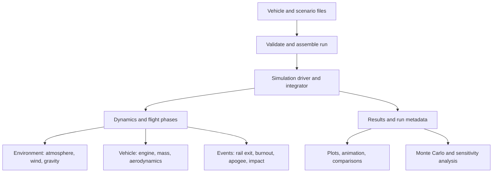

# Rocket Flight Simulator: Project Blueprint

**Status:** Starting design, 25 September 2026  
**Purpose:** Build an original, understandable Python simulator, learn the underlying physics, and produce a credible portfolio project.  
**Scope of this document:** Program architecture and project rules. Mathematical derivations and implementation details come in later milestones.

## 1. What we are building

The primary product is a **flight dynamics simulator**. Given a rocket, a launch scenario, and models of its engine and surroundings, it predicts the rocket's motion over time and explains which modeled forces produced that motion.

The first complete target is a **single-vehicle, single-stage, unguided, fin-stabilized rocket**. A run starts on a launch rail, proceeds through powered ascent and burnout, reaches apogee, and ends at ground contact. A later version adds parachute deployment and descent. The final flight model has **six degrees of freedom (6DOF)**: translation along three axes and rotation about three axes. Orientation can be represented by four quaternion values even though the physical orientation has three rotational degrees of freedom.

This is a simulation of a specified vehicle and assumptions. It is not automatically a validated prediction for a particular real rocket. Initially we will use clearly labeled illustrative inputs; measured vehicle data and flight data, if available and permitted to use, can later improve and validate predictions.

The source documents describe a broader, modular vehicle simulator with fluid networks, structural loads, aeroheating, slosh, recovery, control, and estimation. Those are design directions for later versions, not prerequisites for a working flight simulator. ROCETS and REDES concern detailed **rocket engine and subsystem** simulation; our initial engine is an input to the flight model, not a recreated liquid engine simulation.

## 2. What a run simulates

| Part of the flight | What changes | What the simulator needs to compute |
| --- | --- | --- |
| On the rail | Engine generates thrust; rail constrains motion | Launch conditions, thrust, gravity, mass loss, release from rail |
| Powered ascent | Rocket rises, accelerates, rotates, and encounters changing air | Thrust, atmosphere, wind, aerodynamic forces and moments, changing mass properties |
| Burnout and coast | Engine stops; gravity and air still affect the vehicle | Burnout event, drag, attitude response, apogee |
| Descent | Rocket falls under gravity and aerodynamic forces | Descent trajectory and impact or recovery event |
| Optional recovery | Parachute changes aerodynamic behavior | Deployment conditions and descent behavior |

At each integration step, the software asks: **Where is the rocket? How fast is it moving? Which way is it pointing? How fast is it rotating? How much mass remains?** It evaluates the atmosphere, wind, engine, gravity, and aerodynamics at that state. Newton's laws then give the rates of change; a numerical integrator advances the state in time. Events such as rail exit, burnout, apogee, parachute deployment, and ground contact change phases or mark results.

**State versus results:** Position, velocity, orientation, angular rate, and propellant or total mass are evolving state. Thrust, Mach number, dynamic pressure, acceleration, center of gravity, and stability margin are calculated from state and inputs; they do not all need to be independently integrated. We will keep a single source of truth for each physical quantity.

**Typical outputs:** Time traces and plots of altitude, downrange motion, speed, vertical velocity, acceleration, mass, thrust, Mach, dynamic pressure, angle of attack, pitch/yaw/roll, and center of gravity versus center of pressure. Summary events include rail exit, burnout, maximum dynamic pressure, apogee, recovery deployment when modeled, and ground contact. A run also records its exact inputs, units, model versions, warnings, and solver status.

## 3. Program architecture

The diagram shows the **logical** modules, not one function calling another only once. During a flight, the integrator repeatedly calls dynamics, which queries environment and vehicle models. The event handlers watch for phase transitions. Analysis and plotting happen after the flight solution is available.

### Inputs and configuration

- **Vehicle properties:** Geometry, wet and dry mass, center of gravity and inertia or enough information to derive them, engine thrust and mass-flow profile, aerodynamic coefficient data, and recovery parameters when enabled.
- **Scenario properties:** Launch location and ground elevation, rail direction and length, ambient conditions, wind profile, ignition conditions, and optional dispersions.
- **Solver settings:** Maximum simulation time, integration accuracy, output sampling, event tolerances, and plotting options. Solver settings do not belong in the vehicle's physical description.
- **Data provenance:** Each number must carry a source or be marked an illustrative assumption; each file declares expected units and allowed ranges.

### Physics modules

1. **Atmosphere:** Given altitude, return pressure, temperature, density, and speed of sound. Air density controls drag; pressure can affect thrust. The initial model will cover its documented altitude range and report when queried beyond it.
2. **Wind:** Given location, altitude, and possibly time, return air velocity in the world frame. The aerodynamic model uses velocity *relative to air*, not merely velocity relative to the ground. Start with no wind, then a deterministic profile, then randomized profiles.
3. **Gravity:** Return a downward force based on current mass and altitude. The source material uses an inverse-square change with altitude.
4. **Propulsion and mass properties:** Return thrust, propellant consumption, and associated center of gravity and inertia changes. Start with an explicit thrust curve and mass-flow assumptions; leave a replaceable interface for more detailed engine or fluid models.
5. **Aerodynamics:** Compute aerodynamic forces and moments from air-relative motion, atmospheric density, vehicle geometry, and coefficient data. Start with simple drag, add static stability and pitch/yaw moments, then Mach-dependent lookup tables, damping, and fin effects where data supports them.
6. **Dynamics:** Combine all forces and moments with the rocket's current mass and inertia to calculate translational acceleration, rotational acceleration, and orientation change. It owns frame transformations and flight phase constraints.

### Numerical and analysis modules

- **Integrator:** Numerically solves the evolving equations of motion. We can use SciPy's `solve_ivp` with RK45 initially and compare results under tighter tolerances. It calls the dynamics function; it does not contain the aerodynamic formulas.
- **Events and phases:** Detect rail exit, burnout, apogee, deployment, and impact. Changes such as thrust shutoff and parachute opening should occur at explicit events or between integration phases so results are consistent near transitions.
- **Results store:** Saves state history, derived telemetry, events, run configuration, and model warnings. Plotting reads this output rather than causing physics calculations to run again in a different way.
- **Experiment runner:** Runs a baseline case, then controlled parameter sweeps and seeded Monte Carlo cases. A run should be reproducible with its saved inputs and random seed.
- **Visualization:** Initially altitude and speed versus time; eventually trajectory views, animation, phase markers, uncertainty bands, and comparison between cases.

## 4. Reference frames and data contracts

Reference frames are a frequent source of silent errors. Before coding 6DOF, document the exact convention for the **world frame** (the supplied driver uses North-East-Down, or NED), the **body frame** fixed to the rocket, launch elevation versus altitude above sea level, quaternion order and rotation direction, angular rate signs, and the locations where thrust and aerodynamic forces act. In NED, the down coordinate grows toward Earth. Height above the launch site is the negative of the down displacement when the initial down displacement is zero. Absolute altitude for atmosphere and gravity must include launch-site elevation.

Use **SI units** internally: meters, seconds, kilograms, newtons, radians, and kg·m² for moments of inertia. Input tables should name their coordinate axes and reference area/length. Convert outside data once at the boundary. Fail clearly when mass is negative, a thrust curve is unsorted, a coefficient deck lacks a range, or units are unclear.

The supplied Python driver describes a 20-element state containing position, velocity, quaternion, angular rates, mass, center of gravity, and three diagonal inertias. For an independent first implementation, we can begin with a **14-value core state** (3 position + 3 velocity + 4 orientation + 3 angular rate + 1 mass) and calculate center of gravity and inertia consistently from remaining mass. This is a proposed design choice, **not** a claim about the existing code. If later propellant or slosh dynamics require extra states, we will add them deliberately.

## 5. Project rules

1. **Build in layers.** Make a simple model work and explain it before adding sophistication. Complexity is valuable only when supported by data or by a question the simpler model cannot answer.
2. **Make assumptions visible.** Document modeled effects, omitted effects, input sources, valid altitude/Mach ranges, and the uncertainty they create. Avoid presenting illustrative vehicle predictions as flight-ready values.
3. **Separate inputs, physics, solver, and plots.** A new wind or engine model should use the same interface and should not require rewriting the entire driver.
4. **Use one convention consistently.** Record units, sign conventions, body/world frames, quaternion order, and aerodynamic coefficient definitions alongside each interface.
5. **Test scientific behavior.** Check simple cases against hand calculations: free fall without air, constant thrust in one dimension, zero drag in vacuum, symmetry in zero wind, mass never below dry mass, and sensible event order. Compare with measured data only when such data exists and is appropriate to use.
6. **Check numerical behavior.** Compare key results after reducing step size or tightening solver tolerances. Stop and diagnose if altitude, apogee, or burnout changes materially without a model change.
7. **Keep runs reproducible.** Version input files, save dependency versions and solver settings, and fix random seeds for comparison runs.
8. **Show your own contribution honestly.** Cite source documents and coefficient/data origins. Describe the implementation, design choices, verification, and findings you personally completed. Keep any team-restricted vehicle data out of a public portfolio unless its use is authorized.

## 6. Learning and build sequence

| Milestone | Physics to learn | Deliverable and completion check |
| --- | --- | --- |
| 0. Define the case | Units, position, velocity, acceleration, forces, coordinate axes | A small documented illustrative rocket and launch scenario; no unexplained parameters |
| 1. Vertical 1DOF | Newton's second law; gravity; thrust; changing mass | Altitude, speed, mass, and burnout/apogee plots; simple cases match hand calculations |
| 2. Air and drag | Air density, relative velocity, drag, dynamic pressure | Drag affects ascent and descent in the expected direction; a still-air baseline is repeatable |
| 3. 3D trajectory and wind | Vectors and world/body frames; launch rail; air-relative velocity | Three-position and three-velocity trajectories with correct rail exit, wind response, and impact behavior |
| 4. 6DOF attitude | Torque, moment of inertia, angular rate, quaternions | Rotation responds to moments; a constant-mass, zero-torque case preserves its expected rotation |
| 5. Aerodynamic stability | Angle of attack, center of pressure, center of gravity, coefficient tables | Traceable forces/moments, bounded table queries, documented stability behavior |
| 6. Recovery and experiments | Events and parameter sensitivity | Recovery scenario, editable wind profile, seeded Monte Carlo, comparative plots and animation |
| 7. Validation and portfolio | Model limits, uncertainty, numerical convergence | Reproducible examples, readable documentation, case study with explicit assumptions and evidence |

Each milestone produces a working simulator. The first code milestone is intentionally 1DOF; a partial 6DOF model can conceal sign and frame errors that are much easier to see in a vertical flight.

## 7. Decisions to make when the inputs are ready

- Which *illustrative or approved real vehicle* should be the reference case? The supplied PDFs define model behavior but do not provide a complete, independently usable vehicle configuration and aero decks here.
- Do we have an engine thrust-time curve and mass-flow data, or should the first model use a documented simple profile?
- Are the aerodynamic coefficients and wind profiles available for this project, and what are their units, conventions, and valid ranges?
- Is the first public deliverable purely Python, or do we eventually want a web interface? A command-line Python application with plots is the simplest first product.
- What measured flight or ground-test data can be used to validate outputs? Without such data, we can verify equations and numerical behavior, but cannot assert real-world trajectory accuracy.

**Recommended next move:** Create the milestone-0 vehicle and scenario specification, define the vertical sign convention and assumptions, then derive and implement the 1DOF equations together.

## 8. Source map

These supplied PDFs inform the scope; they are references for our new implementation rather than a complete executable specification.

- `Fullscale Simulation Goals (1).pdf`, pp. 1-2: Python goal list; requests single-run animation and modifiable/randomized winds.
- `NEW FullScale Sim Archectiture (1).pdf`, pp. 1-2: flight-model goal, subsystem map, and possible control feedback loop.
- `traj_6dof_driver.pdf`, pp. 1-6: existing Python driver description, 20-element state, RK45, events, and output plots.
- `How to Access MATLAB Simulator.pdf`, pp. 1-3: existing MATLAB workflow and configurable 1/3/6DOF, wind, recovery, rail, and Monte Carlo options.
- `Aerodynamics.pdf`, pp. 1-11; `Aerodynamic Forces.pdf`, pp. 1-4; `Aerodynamic coefficients.pdf`, pp. 1-4: aerodynamic inputs, tables, geometry, and forces/moments.
- `Atmospheric Model.pdf`, p. 1; `Gravity.pdf`, p. 1; `Thrust Model.pdf`, pp. 1-2; `Equations (1).pdf`, pp. 1-2: individual model concepts and proposed equations. Some detailed equations and sign conventions require independent checking before implementation.
- `Lumped-Parameter Model.pdf`, pp. 1-7: longer-term modular fluids/thermal/control and test-data ambitions.
- `ROCETS.pdf` and `REDES.pdf`: external engine-system inspirations; outside the initial flight-model scope.
